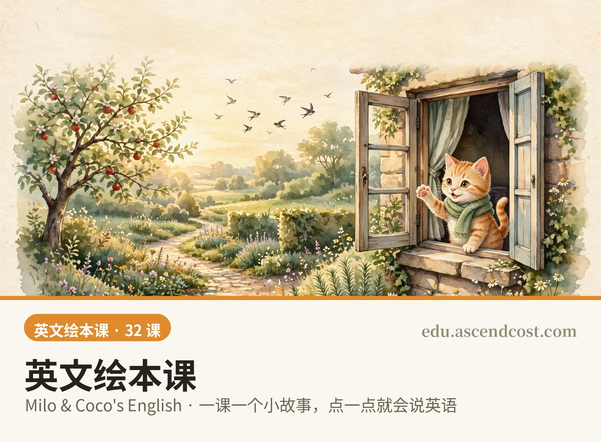

# 英文绘本课 · Milo & Coco's English

## 本地使用（离线包 / GitHub 安装方式）

不用在线也能学，有两种拿法：

1. **下离线包（推荐）**：到本仓库的 [Releases](https://github.com/mydogbro-beep/english-picture-book-course/releases) 下载 `english-picture-book-offline.zip`（只要英文课）或 `ascendcost-edu-full.zip`（三科全集）。解压后双击「启动课堂-Windows.bat」（Windows）或「启动课堂-Mac.command」（Mac），浏览器自动打开课程首页，断网可学。
2. **克隆源码**：`git clone https://github.com/mydogbro-beep/english-picture-book-course.git` —— 仓库里是课程源码与素材（插图、音频、生产脚本），适合二次开发；日常学习请用上面的离线包或在线版。

## 使用介绍

- **直接打开就能学**：在线版 https://edu.ascendcost.com/english/ ，手机、平板、电脑浏览器都可以，不用下载、不用注册。
- **每课怎么学**：先看绘本故事——点画里带橙色圈的角色，它会说出自己的台词；点带绿色圈的物品，听它报出英文名。再翻 10 张词卡，最后做 3 个小练习通关，学完点「下一课」继续。
- **节奏建议**：每课约 10 分钟，一周 3 课左右，一学期学完 32 课。

从零开始的儿童英文绘本课：8 章 32 课，一课一个小故事，水彩绘本插图 + 点读发音 + 可点互动热点（点角色说台词、点物品说单词），对标 CEFR A1 / 剑桥 Starters→Movers。

- 在线版：https://edu.ascendcost.com/english/
- 本仓库为课程源码、插图与音频的公开备份（2026-11-04 首次入仓）
- 主角轮换：Milo＆Coco（第 1–2 章）、小熊 Benny（第 3 章）、松鼠 Pip（第 4 章）、小兔 Ruby（第 5 章）、小狐狸 Felix（第 6 章）、小鸭 Daisy（第 7 章）、第 8 章全员团圆。
- 每课目录含 `img/`（水彩插图）、`audio/`（标准美式发音，已放慢语速）、`spec.json`（课文与热点定义）、成品 HTML 与验收截图 `shots/`；根目录 `课程规划.md` 为总纲，`build_lesson.py` / `gen_audio.py` 为生产脚本。

## 请作者喝杯咖啡

课件免费用，觉得好用可以扫码打赏，支持作者继续做新课。在线版功能最全：https://edu.ascendcost.com/

